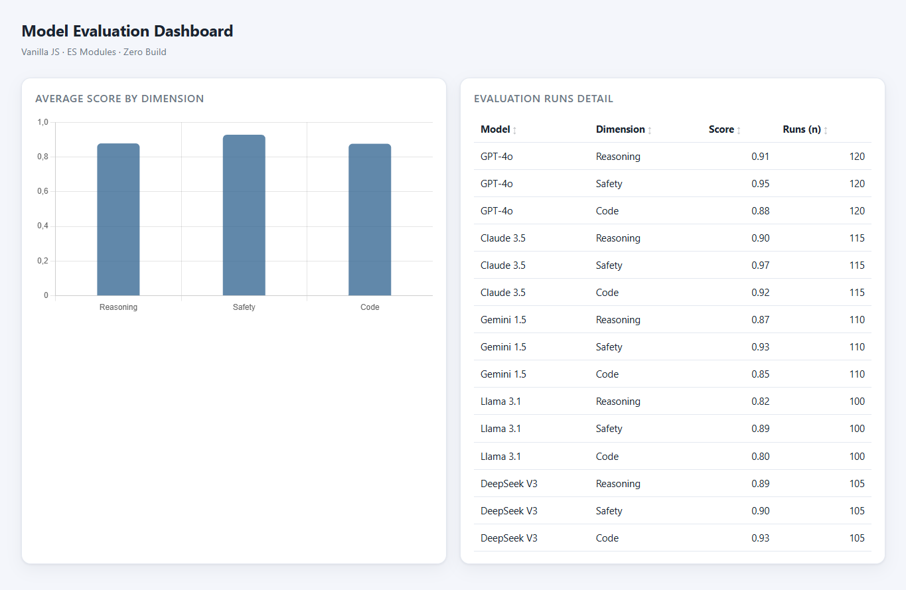

<h1 align="center">📊 JavaScript Dashboard Components</h1>

  
  
  

<b>(English version below | Versão em português abaixo)</b>

---

## 🇺🇸 US English Version

A small, growing library of **vanilla-JavaScript dashboard components** — no framework, no bundler, no `npm install`. Built with native ES Modules and a single CDN dependency (Chart.js), so you can clone it and see it run in seconds.

The demo dataset is shaped like real **LLM-evaluation output** (a score per model per dimension, with sample sizes), which is the analytical context this portfolio lives in: turning structured results into readable, interactive views.

### 🧩 Components (current + roadmap)

| Component | File | Demonstrates | Status |
|---|---|---|---|
| Bar chart | `src/components/barChart.js` | Wrapping Chart.js, safe re-render, accessibility on canvas | ✅ Ready |
| Sortable table | `src/components/sortableTable.js` | DOM building, event handling, generic comparator, sort-state UI | ✅ Ready |
| Live filter / search | `src/components/filter.js` | Input events, derived views, debouncing | 🚧 Next |
| KPI metric cards | `src/components/kpiCards.js` | Aggregation + conditional formatting | 🚧 Planned |
| Light / dark toggle | `src/components/themeToggle.js` | CSS variables + localStorage persistence | 🚧 Planned |

### 🏗 Architecture

- `src/data.js` — single source of truth + pure aggregation helpers (no DOM).
- `src/components/*` — each exports one render function, ignorant of the others.
- `src/main.js` — composition root; wires data to components.
- `styles/theme.css` — theme via CSS custom properties.

This split is deliberate: adding a component touches only main.js, never an existing module. That open/closed discipline is the actual lesson the repo teaches.

### ▶️ How to run

ES Modules are blocked by browsers over file:// (opaque-origin/CORS), so double-clicking index.html will show a blank page with console errors — that is expected, not a bug. Serve the folder over HTTP instead:

    cd javascript-dashboard-components
    python -m http.server 8000

Then open <http://localhost:8000>. Or use VS Code's Live Server extension for automatic reloads.

### ⚖️ Notes

Synthetic data for demonstration. Chart.js loaded from jsDelivr CDN (requires internet on first load). MIT licensed.

---

## 🇧🇷 BR Versão em Português

Uma pequena biblioteca crescente de componentes de dashboard em JavaScript puro — sem framework, sem bundler, sem npm install. Feita com ES Modules nativos e uma única dependência via CDN (Chart.js), para você clonar e ver rodando em segundos.

O dataset de demonstração imita saída real de avaliação de LLMs (uma nota por modelo por dimensão, com tamanhos de amostra) — que é o contexto analítico deste portfólio: transformar resultados estruturados em visões legíveis e interativas.

### 🧩 Componentes (atuais + roadmap)

| Componente | Arquivo | Demonstra | Status |
|---|---|---|---|
| Gráfico de barras | `src/components/barChart.js` | Envolver Chart.js, re-render seguro, acessibilidade no canvas | ✅ Pronto |
| Tabela ordenável | `src/components/sortableTable.js` | Construção de DOM, eventos, comparador genérico, UI de ordenação | ✅ Pronto |
| Filtro/busca ao vivo | `src/components/filter.js` | Eventos de input, vistas derivadas, debounce | 🚧 Próximo |
| Cards de KPI | `src/components/kpiCards.js` | Agregação + formatação condicional | 🚧 Planejado |
| Toggle claro/escuro | `src/components/themeToggle.js` | Variáveis CSS + persistência em localStorage | 🚧 Planejado |

### 🏗 Arquitetura

- `src/data.js` — fonte única da verdade + helpers puros de agregação (sem DOM).
- `src/components/*` — cada um exporta uma função render*(container, data), ignorando os demais.
- `src/main.js` — raiz de composição; liga dados aos componentes.
- `styles/theme.css` — tema via variáveis CSS.

A separação é intencional: adicionar um componente mexe apenas em main.js, nunca num módulo existente. Essa disciplina aberto/fechado é a lição real que o repositório ensina.

### ▶️ Como executar

ES Modules são bloqueados pelo navegador via file:// (origem opaca/CORS), então dar duplo-clique em index.html mostra página em branco com erro no console — isso é esperado, não é bug. Sirva a pasta por HTTP:

    cd javascript-dashboard-components
    python -m http.server 8000

Depois abra <http://localhost:8000>. Ou use a extensão Live Server do VS Code para recarregamentos automáticos.

### ⚖️ Notas

Dados sintéticos para demonstração. Chart.js carregado do CDN jsDelivr (requer internet no primeiro carregamento). Licença MIT.

---

Maintained by <b>Anderson Margalho</b> — Freelance Software Engineer & IT Consultant (Belém, Brazil). Open to research collaborations and freelance projects.

